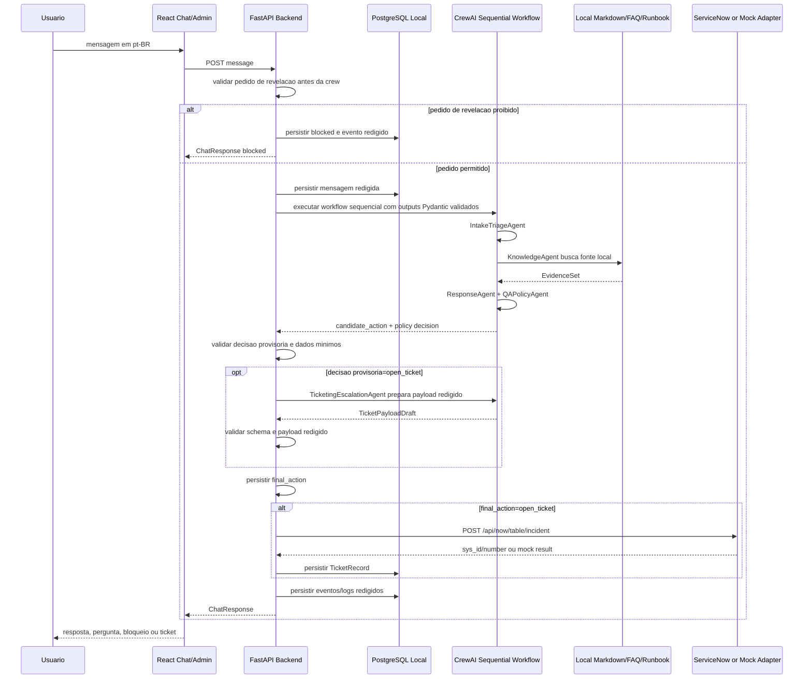

# System Architecture Document (SAD): Multi-Agent Customer Support Crew - MVP Slim

## Context & Instructions

Este SAD atualiza a arquitetura do MVP Slim para a fase Build do AAMAD. O escopo arquitetural fica restrito a uma fatia vertical de IT Help Desk interno em portugues brasileiro:

`chat -> agents -> conhecimento local -> decisao -> resposta ou ticket -> console admin`

O documento respeita o MRD/PRD como fonte de verdade, o runtime `crewai`, processo sequencial, `allow_delegation=false` por padrao, backend Python/FastAPI, frontend React/TypeScript, PostgreSQL local via Docker e integracao ServiceNow Table API para criacao de incidentes.

## Input Requirements

**PRD Document**: `project-context/1.define/prd.md`  
**MRD Document**: `project-context/1.define/mrd.md`  
**Existing SAD Reviewed**: `project-context/1.define/sad.md` anterior  
**Existing SFS Reviewed**: `project-context/1.define/sfs/multi-agent-support-flow.md`  
**Selected Runtime**: `crewai`  
**MVP Scope**: chat web, workflow sequencial CrewAI, busca local em markdown/FAQ/runbook, decisao final validada pelo backend, resposta ou ticket ServiceNow, persistencia PostgreSQL e console admin basico.

## 1. MVP Architecture Philosophy & Principles

### MVP Design Principles

- Entregar primeiro a fatia vertical demonstravel, sem transformar o capstone em plataforma enterprise de ITSM.
- Manter o workflow multiagente sequencial e auditavel, com contratos estruturados entre etapas.
- Usar conhecimento local simples em markdown/FAQ/runbook; vector DB, pgvector e ranking sofisticado ficam fora do P0.
- Tratar o backend como autoridade final para schema, dados minimos, seguranca, persistencia e `final_action`.
- Limitar acoes externas mutating a criacao de incidente ServiceNow via `POST /api/now/table/incident`.
- Redigir ou mascarar secrets/PII antes de persistencia, logs, eventos de agentes e ticketing.
- Tornar o console admin suficiente para demo e debugging, sem RBAC, autenticacao ou niveis de acesso no P0.

### Core vs Future Features

**MVP P0**:

- Web chat em portugues brasileiro.
- Backend FastAPI com endpoints para conversa, tickets, eventos de agentes, fontes usadas e metricas basicas.
- PostgreSQL local via Docker para conversas, mensagens, tickets, eventos de agentes e logs redigidos.
- Workflow sequencial CrewAI com agents/tasks externalizados em YAML.
- Busca local em `knowledge/` com sete arquivos markdown ficticios, aprovados somente para a demo; primeira fatia integrada usa `password_reset`.
- Adapter ServiceNow real para criar incidente.
- Adapter ServiceNow mock/local para desenvolvimento e testes automatizados.
- Console admin aberto para conversas, tickets, fontes, decisoes, eventos e metricas simples.
- Testes unitarios das regras principais e teste de integracao `chat -> agents -> ticket`.

**P1/Future**:

- `handoff_required` como acao separada.
- RBAC, OIDC/autenticacao, multi-tenant e perfis de usuario.
- Slack/Teams, omnichannel e mobile completo.
- Vector DB/pgvector obrigatorio, sincronizacao incremental de conhecimento e sincronizacao incremental ServiceNow.
- OpenTelemetry/APM/SIEM completo, LLM-as-judge e evals sofisticados.
- Acoes externas mutating alem da criacao de incidente ServiceNow.

### Technical Architecture Decisions

| ID | Decision | Rationale | PRD/MRD Trace |
| :-- | :-- | :-- | :-- |
| ADR-001 | Runtime alvo `crewai` com processo sequencial | Alinha com AAMAD config, adapter CrewAI e necessidade de fluxo reproduzivel | PRD Runtime & Agent Specifications; MRD Critical Decision Points |
| ADR-002 | `allow_delegation=false` por padrao | Evita loops agenticos e delegacao opaca no MVP | PRD Runtime & Agent Specifications |
| ADR-003 | Backend FastAPI como boundary central | Centraliza validacao, seguranca, persistencia e integracao externa | PRD Technical Requirements |
| ADR-004 | Frontend React/TypeScript | Stack definida pelo PRD para chat e admin console | PRD Infrastructure Specifications |
| ADR-005 | PostgreSQL local via Docker | Banco P0 definido; evita SQLite como primario | PRD Integration Requirements |
| ADR-006 | Knowledge local em `knowledge/`, sem vector DB obrigatorio, com aprovacao restrita a demo | Sete fontes ficticias por categoria P0; primeiro fluxo usa `password_reset`, sem presumir resolucao para `unknown` | MRD Technical Feasibility; PRD FR-003 |
| ADR-007 | Backend chama adapter ServiceNow real ou mock/local somente apos persistir `final_action=open_ticket` | Agente prepara payload redigido sem acesso a ferramenta mutating; testes independem de ServiceNow externo | PRD FR-006 |
| ADR-008 | Backend persiste `final_action` como autoridade final | `ResponseAgent` propoe `candidate_action`, `QAPolicyAgent` veta, backend valida e grava; `initial_action` de FR-002 e a sugestao inicial, nao uma segunda decisao persistida | PRD FR-002; PRD Decision Rules |
| ADR-009 | Console admin aberto no P0 | Decisao fechada de produto; RBAC/auth ficam fora do MVP | PRD NFR Security & Compliance |
| ADR-010 | Tabelas de telemetria P1 separadas de P0; "nao disponivel" normalizado para campos sem medicao confiavel | Aba IA como incremento P1 nao altera P0; medicao de tokens, tentativas e precos depende de confirmacao Azure Foundry; nao usar zero ficticio | PRD FR-009 Criteria de Aceite; PRD Future Features |

## 2. Multi-Agent System Specification

### Agent Architecture Requirements

O MVP usa cinco papeis agenticos em CrewAI. As definicoes de agents/tasks devem ficar em `config/agents.yaml` e `config/tasks.yaml`; o ponto de entrada pode ser `crew.py` ou modulo equivalente no backend. As quatro tasks centrais (triagem, conhecimento, resposta e policy) usam `Process.sequential`, `output_pydantic` para seus respectivos schemas e `Task.context` apenas com outputs ja validados. A preparacao condicional de ticket tambem usa output estruturado validado, sem acesso a ferramentas mutating.

| Agent | Responsibility | Input | Output | Tool Access |
| :-- | :-- | :-- | :-- | :-- |
| `IntakeTriageAgent` | Classificar solicitacao, categoria, impacto, urgencia, confianca e flags de risco | mensagem redigida, historico curto, estado da conversa | `TriageResult` | taxonomia local, regras deterministicas |
| `KnowledgeAgent` | Buscar fonte local aprovada aplicavel ao problema | `TriageResult`, repositorio local | `EvidenceSet` | leitor/buscador local de markdown/FAQ/runbook |
| `ResponseAgent` | Propor resposta, pergunta de esclarecimento, abertura de ticket ou bloqueio | estado, triagem, evidencias | `ResponseDraft` com `candidate_action` | sem ferramentas mutating |
| `QAPolicyAgent` | Validar seguranca, fonte suficiente, secrets/PII e acao proposta | `ResponseDraft`, triagem, evidencias | `PolicyDecision` | regras de seguranca e validadores |
| `TicketingEscalationAgent` | Preparar payload redigido de incidente proposto, sem executar POST | triagem, contexto redigido e dados minimos | `TicketPayloadDraft` | sem ferramentas mutating |

### Task / Turn Orchestration

1. Frontend envia mensagem para `POST /api/chat/sessions/{session_id}/messages`.
2. Backend valida tamanho e executa bloqueio deterministico antes de invocar a crew para pedidos de revelacao de segredos, credenciais ou dados pessoais de terceiros; nesses casos persiste evento redigido e `final_action=blocked`, sem chamar CrewAI ou ServiceNow. Pedido legitimo de redefinicao de senha nao e pedido de revelacao. Para os demais, cria `request_id`/`agent_run_id`, redige secrets/PII conhecidos e persiste a mensagem redigida.
3. `IntakeTriageAgent` produz `internal_category`, `servicenow_category`, `impact`, `urgency`, `resulting_priority`, `confidence`, `risk_flags` e sugestao inicial equivalente a `initial_action` de FR-002, sem campo concorrente a `candidate_action`/`final_action`.
4. Backend valida taxonomia, impacto/urgencia e prioridade derivada somente de categoria, impacto e urgencia.
5. `KnowledgeAgent` busca em markdown/FAQ/runbook local quando a resposta puder depender de fonte.
6. Backend marca evidencia elegivel quando existe ao menos uma fonte cadastrada como aprovada para a demo, com `internal_category` igual a triagem e `snippet` extraido nao vazio. Arquivo ausente, nao aprovado ou de outra categoria nao sustenta `respond`; `QAPolicyAgent` ainda veta instrucoes nao aplicaveis ou inseguras, conforme FR-003/FR-005.
7. `ResponseAgent` propoe `candidate_action` entre `respond`, `ask_clarification`, `open_ticket` ou `blocked`.
8. `QAPolicyAgent` pode aprovar a proposta ou vetar acao insegura para `blocked`.
9. Backend valida cada output Pydantic antes de passa-lo em `Task.context`; falha interrompe a execucao com erro redigido, sem decisao ou POST. Se a decisao provisoria for `open_ticket`, `TicketingEscalationAgent` prepara `TicketPayloadDraft` redigido, que o backend valida antes de persistir `final_action`. Com outputs validos, backend valida dados minimos, contrato de seguranca, limite de uma pergunta de esclarecimento e persiste `final_action`.
10. Se `final_action=open_ticket` persistida, backend chama o adapter ServiceNow real ou mock/local com payload permitido.
11. Backend persiste resposta, ticket, eventos dos agentes e logs redigidos.
12. Frontend exibe resposta, pergunta, ticket criado ou bloqueio; console admin mostra eventos e decisoes.

### Expected Outputs and Data Formats

Todos os outputs devem ser JSON serializaveis e versionados com `contract_version`, `agent_run_id`, `session_id`, `producer`, `created_at`, `payload` e `validation_errors`.

- `TriageResult`: `internal_category`, `servicenow_category`, `impact`, `urgency`, `resulting_priority`, `confidence`, `risk_flags`, `missing_required_fields`.
- `EvidenceSet`: `sources[]` com `title`, `path`, `snippet`, `internal_category`, `approved=true|false` conforme cadastro local e `supports_operational_instruction=true|false` para revisao pelo policy gate; declaracao do agente nao aprova arquivo.
- `ResponseDraft`: `message_pt_br`, `candidate_action`, `clarification_question`, `ticket_summary`, `source_refs`, `safety_notes`.
- `PolicyDecision`: `approved`, `veto_to_blocked`, `policy_reasons`, `redaction_status`, `safe_for_user`, `safe_for_ticket`.
- `TicketPayloadDraft`: `short_description`, `description`, `impact`, `urgency`, `category` redigidos e validados antes da chamada pelo backend.
- `TicketRecord`: `local_ticket_id`, `servicenow_sys_id`, `servicenow_number`, `adapter_mode`, `status`, `redacted_payload`, `error_code`.

### Agent Contract and Decision Rules

Allowed actions P0: `respond`, `ask_clarification`, `open_ticket`, `blocked`.

- `confidence >= 0.70`: pode seguir sem esclarecimento se fonte, seguranca e dados necessarios forem suficientes.
- `confidence < 0.70`: deve fazer uma pergunta de esclarecimento se nenhuma pergunta anterior foi feita.
- `confidence < 0.70` apos uma pergunta: deve abrir ticket quando o pedido for legitimo e dados minimos forem seguros.
- `respond`: permitido quando categoria for compreendida (nao `unknown`), houver evidencia elegivel quando necessaria e `QAPolicyAgent` aprovar aplicabilidade e seguranca.
- `ask_clarification`: permitido no maximo uma vez por conversa para obter informacao essencial.
- `open_ticket`: permitido quando o usuario pedir ticket, quando fonte for insuficiente para resposta segura, quando baixa confianca persistir apos uma pergunta, ou quando suporte humano for necessario.
- `blocked`: obrigatorio antes da crew para pedidos de revelar secrets, credentials, tokens, passwords, keys ou dados pessoais de terceiros; policy gate pode vetar outros pedidos inseguros.
- `handoff_required` nao e acao P0 e nao deve aparecer em contratos P0.

Taxonomia P0:

- `internal_category`: `password_reset`, `network_wifi`, `app_access`, `printer_label`, `critical_incident`, `applications_issues`, `unknown`.
- `servicenow_category`: `inquiry`, `software`, `hardware`, `network`, `database`.
- Mapeamento: `password_reset -> inquiry`; `network_wifi -> network`; `app_access -> software`; `printer_label -> hardware`; `critical_incident -> software`; `applications_issues -> software`; `unknown -> inquiry`.
- `impact` e `urgency`: `1`, `2` ou `3`.
- `resulting_priority` por exclusao: primeiro `P1 critical` se `critical_incident` ou (`impact=1` e `urgency=1`); senao `P2 high` se `impact=1` ou `urgency=1`; senao `P3 normal` se `impact=2` ou `urgency=2`; senao `P4 low` (`impact=3` e `urgency=3`). Exemplo: `impact=1, urgency=2` resulta em P2, salvo se a categoria for `critical_incident`.
- Prioridade nunca usa tipo de usuario, cargo, VIP, perfil, tier, status externo ou atributo pessoal.

### PII, Credentials and Secrets Flow

- Backend aplica redacao/mascara antes de persistir mensagens, logs, eventos ou tickets.
- `QAPolicyAgent` valida que resposta e ticket nao repetem secrets/PII desnecessaria.
- Secrets, credentials, tokens, passwords e keys sao mascarados ou removidos.
- Pedido para revelar segredo ou dado pessoal de terceiro vira `blocked` por regra deterministica no backend antes da crew; mascarar a entrada nao substitui essa verificacao.
- Ticket automatico usa apenas contexto redigido; se a redacao impedir dados minimos, o backend deve pedir esclarecimento quando permitido ou bloquear quando inseguro.

### Error Handling, Retries, Cancellation and Timeouts

- Falha de schema de qualquer task interrompe o fluxo sem passar output invalido a `Task.context`, sem POST e com erro redigido ao frontend/admin.
- Falha de knowledge local nunca permite resposta inventada; escolhe `ask_clarification` ou `open_ticket` conforme regras.
- Falha ServiceNow preserva ticket local `failed` quando a rejeicao prova ausencia de criacao, ou `outcome_unknown` quando a resposta nao confirma se houve criacao; ambos ficam visiveis no admin.
- `Idempotency-Key` deduplica reenvios locais de um mesmo turno, nao o POST remoto. Nao repetir POST automaticamente apos resultado incerto. Novo envio externo requer reconciliacao manual no ServiceNow e prova de nao criacao; falha confirmada tambem exige acao controlada do operador sobre o mesmo registro.
- Cancelamento de chamada pelo cliente registra evento `cancelled` quando suportado pelo backend.

Na Build atual, o adapter OAuth e o commit anterior ao POST foram cobertos com HTTP simulado e banco isolado. A validacao de token e incidente real na PDI, assim como reconciliacao operacional de resultados incertos, continuam gates de aceite pendentes.

### Runtime-Conditional Configuration: CrewAI

- Required files: `config/agents.yaml`, `config/tasks.yaml`, `crew.py` ou equivalente.
- Process type: `sequential`.
- `allow_delegation=false` por padrao em todos os agentes.
- `memory=False` por padrao; estado de conversa fica no PostgreSQL.
- As quatro tasks centrais declaram `output_pydantic=TriageResult|EvidenceSet|ResponseDraft|PolicyDecision` respectivamente; task condicional de ticket, se executada por CrewAI, declara `output_pydantic=TicketPayloadDraft`.
- `Task.context` encadeia explicitamente apenas outputs previamente validados por schema/guardrail antes da proxima task; backend interrompe a crew quando uma validacao falha.
- `max_iter <= 12`, preferencialmente menor para tasks P0.
- Tool allowlist minima por agente; adapter ServiceNow mutating acessivel somente pelo backend, nunca pelos agentes.
- LLM provider, temperature, max tokens e rate controls ficam em env/config e devem ser registrados nos logs de runtime da Build sem expor secrets.

## 3. Frontend Architecture Specification

### Technology Stack

- React/TypeScript.
- UI em portugues brasileiro.
- API client tipado para backend FastAPI.
- Sem requisito P0 de SSR, mobile completo, autenticacao, RBAC ou biblioteca visual especifica.

### Application Structure

- `ChatPage`: cria/continua conversa, envia mensagem, exibe resposta, pergunta, bloqueio, ticket e fonte usada.
- `AdminConsolePage`: entrada aberta para demo com abas ou secoes simples.
- `TicketsList`: lista tickets locais/ServiceNow e status.
- `ConversationDetail`: mostra mensagens redigidas, eventos de agentes, fonte, decisao final e ticket associado.
- `MetricsSummary`: total de conversas, tickets criados, respostas com fonte e pedidos bloqueados.

### Interface Requirements

- Chat com historico, estado de carregamento e erro recuperavel.
- Exibir titulo/caminho/trecho da fonte quando houver resposta baseada em fonte.
- Exibir justificativa curta da decisao final sem chain-of-thought.
- Console admin sem login no P0, adequado a demo local/controlada.

### P1: Aba IA - Consumo, Custo, Latência e Resultados (FR-009)

A aba IA reutiliza o console admin existente e suas abas sem criar produto separado. Oferece:

**Filtros e Navegação**:
- Periodo temporal (data inicio/fim).
- Modelo utilizado.
- Etapa do workflow (triage, knowledge, response, policy, ticketing).
- Resultado final (`respond`, `open_ticket`, `blocked`, `ask_clarification`, inconclusos).

**Paineis Resumidos**:
- Total de execucoes (`agent_run_id` unicos) no periodo.
- Distribuicao de resultados com percentuais (apenas denominador: execucoes terminais nas tres classes principais).
- Estados inconclusivos separados (em andamento, falha sem acao final, ask_clarification pendente).
- Indicadores de custo estimado, duracao media e p95, moeda e tamanho da amostra.
- Exibir **"nao disponivel"** quando ausencia de execucoes e ausencia de telemetria nao forem distinguiveis.

**Graficos**:
- Evolucao temporal de execucoes por resultado.
- Distribuicao de estados (respond, open_ticket, blocked, inconclusos).
- Distribuicao de latencia por etapa (media, p95, max).

**Tabela de Detalhe por Etapa**:
- `agent_run_id` (link para detalhe da conversa).
- Etapa (triage, knowledge, response, policy, ticketing).
- Modelo utilizado.
- Inicio, fim, duracao (ms).
- Tokens (entrada, saida, cache) com indicacao de **"nao disponivel"** se nao medido.
- Custo estimado com moeda e vigencia de tarifa, ou **"nao disponivel"**.
- Tentativas e falhas (tentativa real observada, retentativa operacional, replay idempotente).
- Estado (completo, em andamento, falha).

## 4. Backend Architecture Specification

### API Architecture

Endpoints P0 recomendados:

- `POST /api/chat/sessions`
- `POST /api/chat/sessions/{session_id}/messages`
- `GET /api/chat/sessions/{session_id}`
- `GET /api/tickets`
- `GET /api/tickets/{ticket_id}`
- `GET /api/agent-runs/{agent_run_id}`
- `GET /api/metrics/summary`
- `GET /api/knowledge/sources`
- `GET /health`

**P1: Endpoints de Observabilidade (FR-009)**:

- `GET /api/ia-tab/summary`: agregacao por periodo, modelo, etapa, resultado (totais, distribuicao, media/p95 duracao, custo estimado total, moeda, tamanho amostra). Exibe "nao disponivel" para campos sem medicao ou tarifa nao cadastrada.
- `GET /api/ia-tab/details`: tabela por `agent_run_id`, etapa com filtros (data inicio/fim, modelo, etapa, resultado); retorna lista paginada com campos: agent_run_id, step_name, modelo, start_time, end_time, duration_ms, tokens_input, tokens_output, tokens_cache, estimated_cost_value, estimated_cost_currency, estimated_cost_validity_start/end, attempt_count, retry_count, replay_count, state.
- `GET /api/ia-tab/timeseries`: evolucao temporal de execucoes, distribuicao de resultados, latencia por etapa.
- `GET /api/ia-tab/pricing-config`: tabela ativa de precos com campos modelo, deployment_id, moeda, tipo_token, tarifa_por_milhao, vigencia.

Campos nao disponiveis retornam `null` com indicacao clara ao cliente para renderizacao "nao disponivel".

Envelope HTTP recomendado:

```json
{
  "data": {},
  "error": null,
  "meta": {
    "request_id": "string",
    "agent_run_id": "string"
  }
}
```

### Data Architecture

Persistencia minima em PostgreSQL local:

- `chat_sessions`: sessao, status, timestamps, `clarification_count`.
- `chat_messages`: mensagens redigidas do usuario/sistema e metadados basicos.
- `agent_runs`: execucoes, status, duracao, modelo/config resumida, erro redigido.
- `agent_events`: eventos por etapa, inputs/outputs estruturados redigidos e decisao.
- `knowledge_sources`: arquivo local, titulo, path, categoria interna e status aprovado.
- `tickets`: ticket local, `servicenow_sys_id`, `servicenow_number`, categorias, impacto, urgencia, `resulting_priority`, status e payload redigido.
- `app_logs`: logs estruturados redigidos quando nao forem armazenados apenas em arquivos/STDOUT.

**P1: Tabelas de Observabilidade (FR-009)**:

- `agent_run_telemetry`: chave unica `(agent_run_id, step_index)`, identificador de etapa (ex.: "intake_triage", "knowledge_search", "response_generation", "qa_policy", "ticketing"), modelo efetivamente utilizado, timestamps inicio/fim, estado (complete, running, failed), tokens entrada/saida/cache (NULL se nao medido), custo estimado em moeda (NULL se nao disponivel).
- `agent_run_attempts`: rastreio de tentativas por etapa com contador de tentativa real observada (chamadas ao provider), retentativa operacional (re-execucao da etapa), replay idempotente (resposta cacheada), com timestamp e resultado (success, failure).
- `pricing_config_versions`: tabela versionada de precos com campos modelo, deployment_id, moeda, tipo_token (entrada, saida, cache), tarifa_por_milhao, data_inicio, data_fim, ativo (boolean), criado em. Uma entrada ativa por modelo/deployment/tipo_token/moeda/periodo.
- `agent_run_results_summary`: resultado final agregado por `agent_run_id` (respond, open_ticket, blocked, ask_clarification, failed, running) com timestamp persistencia.

Nao ha tabelas P0 para tenants, roles, permissoes, OIDC identities ou perfis de prioridade.

**Contrato de Medicao**:
- Campos de token/custo exibem valor medido somente quando fornecido pelo CrewAI/provider com confiabilidade.
- Presenca de campo em `CrewOutput` nao comprova medicao; normalizar documentando **"nao disponivel"** sem inferir zero.
- Soma agregada de tokens por `agent_run_id` ocorre somente para campos medidos; indicar cobertura parcial.
- Falha de `kickoff()` sem `CrewOutput` nao permite persistencia de consumo parcial; exibir **"nao disponivel"**.
- Custo estimado calcula-se somente a partir de tokens medidos + tarifa vigente na data da execucao.
- Tarifa sem preco valido, moeda compativel ou consumo suficiente resulta em **"nao disponivel"**, jamais zero ficticio.
- Cache: quando tokens cache forem subconjunto de entrada, precificar entrada nao armazenada e cache separadamente. Se a relacao nao puder confirmarse, custo fica indisponivel.
- A aba IA exibe e agrega custos somente em USD; tarifas em outras moedas nao sao aceitas para calculo e nao ha conversao cambial em P1.

**Contrato de Resultados**:
- `respond`: resolvido no chat sem ticket.
- `open_ticket`: escalonado para ServiceNow.
- `blocked`: bloqueado pre-crew (pedido inseguro) ou pos-policy (acao rejeitada).
- `ask_clarification`: aguardando pergunta do usuario.
- `failed`: execucao com erro sem acao final definida.
- `running`: execucao em andamento.
- Replays nao entram no denominador de percentuais.

Nao ha tabelas P0 para tenants, roles, permissoes, OIDC identities ou perfis de prioridade.

### Runtime Integration Layer

- `AgentRuntimeService` encapsula CrewAI e normaliza entradas/saidas.
- Validadores Pydantic ou equivalentes verificam contratos antes/depois de cada task.
- O backend calcula e persiste `final_action`; agentes nao gravam diretamente no banco.
- Somente o backend chama o adapter ServiceNow apos confirmar `final_action=open_ticket` persistida e validar o payload redigido preparado pelo agente de ticketing.
- Prompt/runtime trace na Build deve redigir secrets e pode registrar hashes/templates em vez de texto sensivel.

**P1: Captura de Telemetria (FR-009)**:

- Apos cada etapa da crew (IntakeTriageAgent, KnowledgeAgent, ResponseAgent, QAPolicyAgent, TicketingEscalationAgent), persistir em `agent_run_telemetry` os campos:
  - `agent_run_id`, `step_index`, `step_name`.
  - `model_used`: modelo reportado pela etapa ou `CrewOutput`.
  - `timestamp_start`, `timestamp_end` (ISO 8601 UTC).
  - `state`: 'complete', 'running', 'failed'.
  - `tokens_input`, `tokens_output`, `tokens_cache` (NULL se nao fornecido pelo provider).
  - `estimated_cost_value` (calculado apenas se tokens + tarifa vigente disponivel), `estimated_cost_currency`, `pricing_config_id` (referencia da linha ativa de preco).
- Se `kickoff()` falha, `CrewOutput` nao e persistido; etapas completadas ate falha podem ter telemetria, etapas nao alcancadas resultam em "nao disponivel".
- Instrumentar cada chamada de `stage()` no backend: registrar inicio UTC e `time.perf_counter()` antes de `kickoff()`, e fim UTC e diferenca monotonicamente medida em milissegundos no caminho de sucesso ou falha. A duracao inclui `kickoff()` e validacao da etapa, nao representa somente latencia do provider. Eventos `TaskStartedEvent`, `TaskCompletedEvent` e `TaskFailedEvent` podem auxiliar no diagnostico, mas nao substituem a medicao da etapa (inclusive falhas antes da task).
- Eventos `LLMCallStartedEvent`, `LLMCallCompletedEvent` e `LLMCallFailedEvent` permitem observar chamadas logicas do CrewAI por `task_id`/`agent_role` e `call_id`, sem persistir mensagens ou respostas. Inicio pode ocorrer antes de hooks e do envio ao provider; retries do adapter/SDK podem ocorrer sem novo evento. Registrar tentativas reais em `agent_run_attempts` somente com instrumentacao validada no limite do transporte/provider que observe cada envio; caso contrario, exibir "nao disponivel" para esse contador. `successful_requests` nao e proxy de tentativas reais.
- Replays idempotentes (respostas cacheadas/reutilizadas) sao registrados em `agent_run_attempts` com `attempt_type='replay'`, nao incrementando tokens, custo nem falhas de etapa.
- Privacidade: nenhum dado de telemetria armazena prompts, respostas brutas, secrets ou PII; segue a redacao existente de eventos.

### ServiceNow Ticketing Integration Contract

Endpoint: `POST /api/now/table/incident`.

Payload outbound permitido e suficiente no P0:

```json
{
  "short_description": "Short issue summary",
  "description": "Relevant redacted context",
  "impact": "2",
  "urgency": "2",
  "category": "software"
}
```

Regras:

- Campos obrigatorios: `short_description`, `description`, `impact`, `urgency`, `category`.
- `TicketingEscalationAgent` prepara esses campos sem ferramenta externa; o backend valida e persiste `final_action=open_ticket` antes de enviar o POST pelo adapter.
- `priority` nao deve ser obrigatorio nem enviado como contrato P0.
- `resulting_priority` e calculada pela aplicacao para exibicao, auditoria e testes.
- Dados minimos para abrir ticket: descricao do problema, entendimento de `impact` e entendimento de `urgency`.
- `category` usa apenas `inquiry`, `software`, `hardware`, `network` ou `database`.
- Adapter mock/local deve implementar o mesmo contrato de request/response relevante para testes.

### Configuration and `.env` Strategy

Variaveis esperadas para `.env.example` da Build:

- `AAMAD_TARGET_RUNTIME=crewai`
- `APP_ENV=local`
- `DATABASE_URL=postgresql://...`
- `LLM_PROVIDER`
- `LLM_API_KEY`
- `SERVICENOW_BASE_URL`
- `SERVICENOW_INCIDENT_TABLE_PATH=/api/now/table/incident`
- `SERVICENOW_CLIENT_ID`
- `SERVICENOW_CLIENT_SECRET`
- `SERVICENOW_AUTH_MODE=oauth`
- `TICKET_ADAPTER_MODE=mock|servicenow`
- `KNOWLEDGE_BASE_PATH`
- `LOG_LEVEL`

Valores reais nunca devem ser commitados.

## 5. DevOps & Deployment Architecture

### Docker/PostgreSQL Local

- A fase Build deve fornecer `docker-compose.yml` ou equivalente para PostgreSQL local.
- Backend usa `DATABASE_URL` e migrations simples.
- ServiceNow real pode ser desligado localmente via `TICKET_ADAPTER_MODE=mock`.
- `KNOWLEDGE_BASE_PATH` aponta para `knowledge/`, com sete fontes ficticias aprovadas para a demo; o teste inicial usa `password_reset` e o dataset final de 8-12 casos fica para marco posterior do P0.

### CI/CD

Pipeline minimo recomendado:

- Instalar dependencias backend/frontend.
- Rodar lint/typecheck quando configurado.
- Rodar unit tests de regras principais.
- Rodar integration test `chat -> agents -> ticket` com adapter mock/local.
- Rodar build frontend/backend.

### Environments

- `local`: Postgres Docker, ServiceNow mock por default, knowledge local, logs verbosos.
- `demo`: single-tenant, ServiceNow real quando credenciais estiverem presentes, dados sinteticos/redigidos.
- Ambientes `staging`/`production` ficam Future.

### Observability

P0 registra:

- `request_id`, `session_id`, `agent_run_id`, `ticket_id`.
- Status e duracao por endpoint/task.
- `final_action`, categoria, impacto, urgencia e fonte usada.
- Falhas ServiceNow/mock, falhas de schema e bloqueios de seguranca.
- Logs estruturados redigidos.

OpenTelemetry, APM, SIEM, tracing distribuido e dashboards avancados ficam P1/Future.

## 6. Data Flow & Integration Architecture

### Primary Request/Response Path



### External Systems and Integration Points

- **LLM provider**: inferencia para agentes, configurado via env vars.
- **Knowledge local**: sete arquivos markdown ficticios em `knowledge/`, um por categoria P0, aprovados exclusivamente para demo.
- **PostgreSQL local**: persistencia operacional P0.
- **ServiceNow Table API**: criacao de incidente via `POST /api/now/table/incident`.
- **ServiceNow mock/local**: substituto local para testes e desenvolvimento.

### Error Propagation

- Erros externos viram eventos redigidos e resposta segura ao usuario.
- Falha ServiceNow nao descarta conversa; preserva ticket local com erro.
- Falha de knowledge nao autoriza resposta sem fonte quando fonte for necessaria.

## 7. Performance & Scalability Specifications

### MVP Targets

- O fluxo deve parecer responsivo em demo; sem meta p95 rigida prometida no PRD.
- O teste de integracao deve completar em janela pratica para 8-12 casos.
- Timeouts ServiceNow devem retornar erro recuperavel e visivel no admin.

### Scaling Path

- Separar API e worker CrewAI.
- Adicionar fila para execucoes longas.
- Melhorar retrieval/ranking local.
- Introduzir autenticacao, RBAC e isolamento de tenant.
- Avaliar vector DB apenas apos validar a fatia vertical.

### Token and Cost Controls

- Limitar historico enviado ao runtime.
- Limitar numero de fontes por resposta.
- Registrar modelo, tokens/custo estimado quando disponivel.
- `max_rpm`, temperature e max tokens devem ser configuraveis.

### P1: Latência, Preços e Contadores de Tentativas (FR-009)

**Latência por Etapa**:
- Medir no wrapper `stage()` do backend, do inicio de `kickoff()` ate a validacao ou excecao, inclusive em falha, usando `time.perf_counter()` para duracao em milissegundos e timestamps UTC para exibicao. Nao subtrair timestamps de eventos CrewAI nem confundir latencia da etapa com tempo de rede do provider.
- Apresentar em agregacao:
  - **Media**: sum(duracao) / count.
  - **p95 (Nearest Rank)**: valor no percentil 95 de amostras ordenadas.
  - **Max**: maior duracao observada.
- Agregar duracoes medidas por etapa e por execucao; replays idempotentes nao executam etapas e nao entram nas amostras de latencia de etapas.
- Latencia total de `agent_run_id`: soma de todas as etapas + overhead de orquestracao.
- Execucoes em andamento aparecem separadamente, sem duracao final ficticia.
- Quando amostra < 10 execucoes, indicar tamanho da amostra; p95 e media podem ser identicos.

**Tabela de Precos Versionada**:

| Modelo | Deployment | Moeda | Tipo Token | Tarifa (por 1M) | Vigencia Inicio | Vigencia Fim | Ativo |
| :-- | :-- | :-- | :-- | :-- | :-- | :-- | :-- |
| `gpt-6-sol` | `azure/gpt-6-sol` (a confirmar) | USD | entrada | $2.00 | TBD | TBD | false |
| `gpt-6-sol` | `azure/gpt-6-sol` (a confirmar) | USD | entrada_cache | $0.20 | TBD | TBD | false |
| `gpt-6-sol` | `azure/gpt-6-sol` (a confirmar) | USD | escrita_cache | $2.50 | TBD | TBD | false |
| `gpt-6-sol` | `azure/gpt-6-sol` (a confirmar) | USD | saida | $10.00 | TBD | TBD | false |

**Calculo de Custo Estimado**:
- Custo = (tokens_entrada * tarifa_entrada + tokens_cache * tarifa_cache + tokens_saida * tarifa_saida) / 1.000.000.
- Se tokens_cache sao subconjunto de tokens_entrada, custo_entrada_nao_armazenada = (tokens_entrada - tokens_cache) * tarifa_entrada + tokens_cache * tarifa_cache.
- Sem relacao confirmada, o custo fica **"nao disponivel"**.
- Aplicar tarifa vigente na data da execucao; preservar versao do preco em `pricing_config_id` para auditoria.
- Resultado final identificado como **"estimativa"**.
- **Jamais exibir custo zero ficticio**. Sem tarifa valida, moeda compativel ou consumo suficiente, mostrar **"nao disponivel"**.

**Dependencias para Habilitar Estimativas**:
- Confirmar no Azure Foundry: SKU exato de `azure/gpt-6-sol`, tipo e regiao do deployment, faixa de contexto, preco contratado e inicio/fim de vigencia.
- Cadastrar tarifa aplicavel em `pricing_config_versions` com flags de ativo=true e vigencia apropriada.
- Dispor de consumo de tokens confiavel do provider para 20+ execucoes.
- **Sem confirmacao e cadastro, exibir "nao disponivel"**, nao presumir equivalencia automatica com tarifa publica.

**Referencia Publica (Planejamento Apenas, Nao Tarifa Aplicavel)**:
- Fonte: Microsoft Azure OpenAI pricing (2026-01-XX).
- Modelo GPT-6 Sol, Global Standard, contexto curto.
- Hipotese: 1.000 tokens entrada + 500 tokens saida por etapa, sem cache.
- Custo por etapa: (1.000 / 1.000.000 * $2.00) + (500 / 1.000.000 * $10.00) = $0.007.
- Se 5 etapas por execucao com consumo identico: $0.035/execucao, $35/1.000 execucoes.
- Sao premissas de volume e tarifa publica, nao medicoes de uso nem previsao de fatura.

**Contadores de Tentativas e Replays**:
- **Tentativa real**: envio observado ao LLM provider no limite do transporte, incluindo retries internos apenas quando instrumentados; eventos de chamada logica do CrewAI e `successful_requests` nao sao proxy.
- **Retentativa operacional**: nova execucao da etapa com referencia a original (e uma execucao propria persistida).
- **Replay idempotente**: reutilizacao de resposta persistida; nao incrementa execucoes, tokens, custo nem falhas.
- **Falha de etapa**: erro sem resposta final nessa etapa.
- Contar separadamente, sem inferir uma tentativa a partir de `kickoff()` bem-sucedido.
- Exibir quatro contadores com definicoes no painel.

**Migracao de Dados Historicos**:
- Registros anteriores ao incremento P1 permanecen visiveis com metricas ausentes como **"nao disponivel"**.
- Nao reprocessar ou fazer backfill de consumo inferido.
- Timestamp de primeira telemetria persistida marca inicio de cobertura para cada execucao.

## 8. Security & Compliance Architecture

### AuthN/AuthZ

- Console admin P0 e aberto, sem RBAC, niveis de acesso ou autenticacao.
- O MVP e single-tenant.
- Qualquer autenticacao/OIDC entra em P1/Future.

### Security Baselines

- Secrets somente via env vars ou secret manager futuro.
- Nenhum segredo em codigo, logs, Prompt Trace, datasets ou tickets.
- Redacao/mascara basica para tokens, passwords, keys e credentials.
- Bloqueio de pedidos inseguros envolvendo secrets ou dados pessoais de terceiros.
- Validacao de input/output em endpoints e contratos dos agentes.
- Tool allowlist minima; ServiceNow mutating adapter restrito ao backend, sem acesso dos agentes.

### Compliance Considerations

- Compliance enterprise formal fora do P0.
- Dados de demo devem ser sinteticos ou redigidos.
- Retencao, delecao e politicas LGPD completas ficam Future caso haja uso real.

## 9. Testing & Quality Assurance Specifications

### Test Strategy

- Unit tests para taxonomia, mapeamento ServiceNow, prioridade P2 em `impact=1, urgency=2`, regra de confidence, limite de uma pergunta, fonte vazia/ausente/nao aprovada/de outra categoria, redacao basica e payload ServiceNow.
- Unit tests para bloqueio pre-crew sem chamada aos agentes, falha de schema sem passagem de context nem POST, persistencia de `final_action=open_ticket` anterior ao POST, e ausencia de `priority` obrigatorio no payload outbound.
- Primeiro integration test `password_reset` com fonte em `knowledge/`, PostgreSQL local e `TICKET_ADAPTER_MODE=mock`; verificar exibicao de titulo/caminho/trecho da fonte ou numero de incidente mock. Expandir depois para os demais fluxos P0 usando `project-context/1.define/support-cases.json`.
- No dataset, `expected_source` e o documento recuperado por classificacao/RAG para justificar a decisao; nao implica exibicao da fonte ao usuario. Para `test_mode=deterministic`, o fixture assume categoria correta, confianca acima do limiar de escalonamento, dados minimos presentes e nenhuma pergunta adicional exceto quando `expected_action=ask_clarification` (TC004). TC012 permanece excecao: bloqueio pre-crew, sem categoria ou fonte recuperada. Essas premissas valem somente para testes e nao alteram a politica de confianca em producao.
- Teste condicionado com ServiceNow real apenas quando variaveis estiverem presentes.

### Runtime-Specific Quality Checks

- Validar `config/agents.yaml` e `config/tasks.yaml`.
- Confirmar `process=sequential` e `allow_delegation=false`.
- Confirmar `output_pydantic` nas quatro tasks centrais, `Task.context` somente com outputs validados e tool allowlist sem adapter mutating para agentes.
- Validar que `QAPolicyAgent` roda antes de resposta final ou ticket.

### PRD Coverage Review

| PRD item | SAD coverage | Status |
| :-- | :-- | :-- |
| FR-001 Web Chat | Frontend, API chat, persistencia de mensagens | Covered |
| FR-002 Intake & Triage | `IntakeTriageAgent`, taxonomia, prioridade | Covered |
| FR-003 Local Knowledge Search | Knowledge local e criterio de fonte suficiente | Covered |
| FR-004 Response Generation | `ResponseAgent`, pt-BR, fonte e uma pergunta | Covered |
| FR-005 QA & Policy Gate | `QAPolicyAgent`, redacao, bloqueios | Covered |
| FR-006 ServiceNow Ticketing | Adapter real/mock e contrato Table API | Covered |
| FR-007 Basic Admin Console | Tickets, conversa, eventos, fontes, metricas | Covered |
| FR-008 QA And Basic Observability | Unit tests, integration test, logs/eventos | Covered |
| FR-009 Aba IA (P1) | Tabelas de telemetria, APIs, filtros, paineis, precos, latencia, tentativas | Covered (P1 increment) |

### Evaluation Criteria

O MVP nao exige LLM-as-judge nem evals sofisticados. A fase Build deve validar os criterios abaixo com testes code-based e, quando necessario, revisao manual simples:

| ID | Dimension | Metric | Threshold | Grading Method | Source |
| :-- | :-- | :-- | :-- | :-- | :-- |
| EC-001 | Accuracy | Categorias P0 classificadas no dataset | Pelo menos 5 categorias principais cobertas | Unit/integration dataset | PRD Success Metrics |
| EC-002 | Safety | Secrets intencionais persistidos em logs de testes | 0 ocorrencias | Log scan/test assertion | PRD Technical Metrics |
| EC-003 | Ticketing | Payload ServiceNow contem campos obrigatorios e nao exige `priority` | 100% dos casos de ticket | Contract test | PRD ServiceNow Ticketing Contract |
| EC-004 | Workflow | Integration test `chat -> agents -> ticket` | Passa com mock/local | Integration test | PRD FR-008 |
| EC-005 | UX | Resposta com fonte mostra titulo/caminho/trecho | 100% quando fonte usada | UI/API assertion | PRD FR-003/FR-007 |
| EC-006 | Telemetry (P1) | Tabela de precos cadastrada com tarifa ativa; 20+ execucoes com tokens confiavel | Nao aplicavel se confirmacao Azure Foundry pendente | Data validation + pricing config check | PRD FR-009 |
| EC-007 | Latency (P1) | Media e p95 de duracao de etapas; replays nao incrementam contadores | 100% dos registros com latencia medida | Query assertion | PRD FR-009 |
| EC-008 | Privacy (P1) | Zero secrets/PII em telemetria; migracao de dados com "nao disponivel" | 0 ocorrencias de PII em agent_run_telemetry | Log/DB scan | PRD FR-009 |

## 10. MVP Launch & Feedback Strategy

### Pilot Criteria

- Backend, frontend, PostgreSQL e mock ServiceNow sobem localmente.
- ServiceNow real cria incidente quando credenciais estiverem configuradas.
- `knowledge/` aprovado somente para demo; primeiro teste integrado `password_reset` usa PostgreSQL e adapter mock antes de expandir para demais categorias P0.
- Unit tests principais e integration test P0 passam.
- Console admin mostra conversa, ticket, fonte, eventos e metricas basicas.

### Success Metrics

- Chat cria e mantem conversa.
- Ticket ServiceNow/mock criado com `short_description`, `description`, `impact`, `urgency` e `category`.
- Console admin mostra ticket, conversa, fonte e decisao final.
- Dataset de 8-12 casos cobre fluxos principais definidos no PRD.

### SFS Impact

O arquivo `project-context/1.define/sfs/multi-agent-support-flow.md` foi mantido e substituido por uma SFS menor porque o fluxo integrado `chat -> agents -> ticket` e P0, reduz ambiguidade para frontend/backend/integration e ajuda diretamente o teste de integracao. O conteudo antigo foi removido quando tratava espanhol, `handoff_required`, vector/hybrid search, dataset 20-30, OIDC/RBAC ou outros itens P1/Future como se fossem P0.

## Implementation Guidance for AI Development Agents

1. `@project.mgr`: criar scaffold React/TypeScript, FastAPI, PostgreSQL Docker, env example, config CrewAI e estrutura de testes.
2. `@frontend.eng`: implementar chat e console admin basico em pt-BR.
3. `@backend.eng`: implementar schemas, persistencia, endpoints, runtime service, redacao e adapters ServiceNow real/mock.
4. `@integration.eng`: conectar frontend/backend/CrewAI/knowledge/ticketing no fluxo P0.
5. `@qa.eng`: implementar unit tests e integration test `chat -> agents -> ticket`.
6. `@security.eng`: revisar secrets, PII, logs, env vars e tool allowlist.
7. `@devops.eng`: empacotar compose, runbook, user guide e CI minimo.

## Architecture Validation Checklist

- [x] MRD, PRD, config AAMAD e adapter CrewAI revisados.
- [x] Runtime resolvido `crewai` registrado.
- [x] Escopo P0 limitado ao MVP Slim.
- [x] Itens P1/Future removidos do P0.
- [x] ServiceNow Table API e payload confirmado documentados.
- [x] `priority` nao e obrigatorio no payload outbound.
- [x] `handoff_required` movido para P1/Future.
- [x] Decisao sobre SFS registrada.

## Sources

- `AGENTS.md`
- `.github/instructions/aamad-core.instructions.md`
- `.github/instructions/adapter-crewai.instructions.md`
- `aamad.config.yml`
- `project-context/1.define/mrd.md`
- `project-context/1.define/prd.md`
- `project-context/1.define/sad.md` anterior, revisado e substituido
- `project-context/1.define/sfs/multi-agent-support-flow.md` anterior, revisado e substituido
- `src/backend/app/runtime/crew.py` (uma `Crew.kickoff()` por etapa e tratamento de falhas)
- CrewAI instalado: `events/types/llm_events.py`, `events/types/task_events.py`, `llms/providers/openai/completion.py` e `task.py` (eventos, hooks e retries)
- Solicitacao do operador em 2026-09-26 com decisoes fechadas do MVP Slim
- Plano aprovado pelo operador em 2026-10-05: sete fontes ficticias aprovadas somente para demo, `unknown` limitado a coleta/escalonamento e primeiro fluxo `password_reset`.

## Assumptions

- `AAMAD_TARGET_RUNTIME` nao foi fornecido no ambiente da execucao; o runtime resolvido foi `crewai` a partir de `aamad.config.yml`, MRD e PRD.
- O operador definiu OAuth para ServiceNow; a PDI deve disponibilizar credenciais OAuth, configuradas por `.env` na Build. O SAD nao registra valores secretos.
- O operador aprovou sete arquivos ficticios em `knowledge/` somente para demo e os 12 casos representativos em `project-context/1.define/support-cases.json` para a validacao P0.
- Console admin aberto e aceitavel apenas para ambiente local/demo single-tenant.
- A SFS permanece necessaria apenas como especificacao funcional curta do fluxo integrado P0; demais detalhes ficam no PRD/SAD para evitar duplicacao.

**P1: Assumptions sobre Telemetria e Precos (FR-009)**:
- CrewAI fornece `CrewOutput` com agregacoes de tokens por etapa quando `kickoff()` bem-sucedido; nao presume zero para campos ausentes.
- Adapter `azure/gpt-6-sol` e configurado conforme ambiente; SKU, deployment, regiao e tarifa sao pendentes de confirmacao com Azure Foundry.
- Tarifa publica de $2.00/$10.00/etc. nao presume equivalencia com preco contratado; necessaria confirmacao explicita.
- CrewAI fornece eventos de chamadas logicas e tasks, mas nao contador confiavel de envios reais ao provider incluindo retries internos; estes exigem instrumentacao de transporte validada.
- Duracao por etapa e medida no backend com relogio monotonicamente crescente, inclusive em falha; a aba IA opera somente em USD, sem conversao cambial.
- Replays idempotentes sao distinguiveis por estado de cache/persistencia; nao inferir replay a partir de `kickoff()` bem-sucedido.
- Migracao de dados historicos (anterior ao incremento P1) preserva registros com metricas como "nao disponivel", sem backfill.

## Open Questions

- **Azure Foundry SKU e Tarifa (Bloqueante para FR-009 Pricing)**: Qual e o SKU exato de `azure/gpt-6-sol`, tipo de deployment (por exemplo, Global Standard), regiao, faixa de contexto, preco contratado USD por 1M tokens (entrada, saida, cache quando aplicavel) e datas de vigencia? Sem confirmacao e cadastro em `pricing_config_versions`, a aba IA exibira "nao disponivel" para custo estimado.

## Audit

- Data: 2026-10-19; decisao do operador: aba IA somente em USD. Pesquisa no runtime local: eventos CrewAI observam chamadas logicas e tasks, nao garantem cada envio/retry do SDK; medir duracao da etapa no backend com `time.perf_counter()` inclusive em falha. Fechadas as tres questoes de tentativas, latencia e conversao; SKU/tarifa Azure permanece pendente. Validacao: `git diff --check`.
- Data/hora: 2026-10-19T20:36:43-03:00
- Persona id: `system-arch`
- Acao executada: `update-sad-with-fr-009`
- Traceabilidade: PRD FR-009 (linhas 188-226 de prd.md) com criterios de aceite, dependencias, precos e privacidade.
- Runtime resolvido: `crewai`
- AAMAD_TARGET_RUNTIME: `crewai` (resolvido de `aamad.config.yml`)
- Secoes atualizadas:
  - 3. Frontend: adicionada subsecao "P1: Aba IA" com descricao de filtros, paineis, graficos e tabela de detalhe por etapa.
  - 4. Backend: expandido "Data Architecture" com tabelas `agent_run_telemetry`, `agent_run_attempts`, `pricing_config_versions`, `agent_run_results_summary` e contrato de medicao; expandido "API Architecture" com endpoints P1 de observabilidade; expandido "Runtime Integration Layer" com captura de telemetria, privacidade e tratamento de falhas.
  - 7. Performance: adicionada subsecao "P1: Latencia, Precos e Contadores" com especificacoes de duracao, tabela de precos versionada, calculo de custo (com hipotese publica mas nao confirmada para gpt-6-sol), dependencias de confirmacao Azure Foundry, contadores de tentativa/retry/replay.
  - 9. Testing: atualizada tabela "PRD Coverage Review" com FR-009; adicionados criterios de avaliacao EC-006 (telemetry), EC-007 (latency), EC-008 (privacy).
  - Assumptions: adicionadas premissas P1 sobre CrewAI, SKU pendente, tarifa publica nao presume contrato, callbacks de tentativas, migracao de dados historicos.
  - Open Questions: adicionadas tres questoes bloqueantes e pendentes de confirmacao operador sobre Azure Foundry SKU/tarifa, telemetria de tentativas CrewAI e conversao de moedas.
- Ferramentas/arquivos lidos: `prd.md` (linhas 180-226); `sad.md` anterior completo; `.github/agents/system-arch.agent.md`.
- Prompt Trace: omitido porque artefato de arquitetura da fase Define; fontes, decisoes e rastreabilidade sao registradas em Sources, Assumptions, Open Questions e Audit.
- Preservacao de P0: escopo P0 intacto (chat, triage, knowledge, response, policy, ticketing, console admin basico); P1 adicionado como incremento sem alterar P0 ou contratos existentes.
- Preservacao de "nao disponivel": campo normalizado preservado em telemetria quando medicao nao disponivel (ausencia de CrewOutput apos falha, tokens nao fornecidos pelo provider, tarifa nao cadastrada, cache nao distinguivel de entrada).
- Data/hora resolucao runtime: registrada em Audit.
- Revisao final: alinhamento com aamad-core.instructions.md (context-first, reproducibility, minimal viable, deterministic) e adapter-crewai.instructions.md (external YAML, sequential process, output_pydantic, task guardrails).